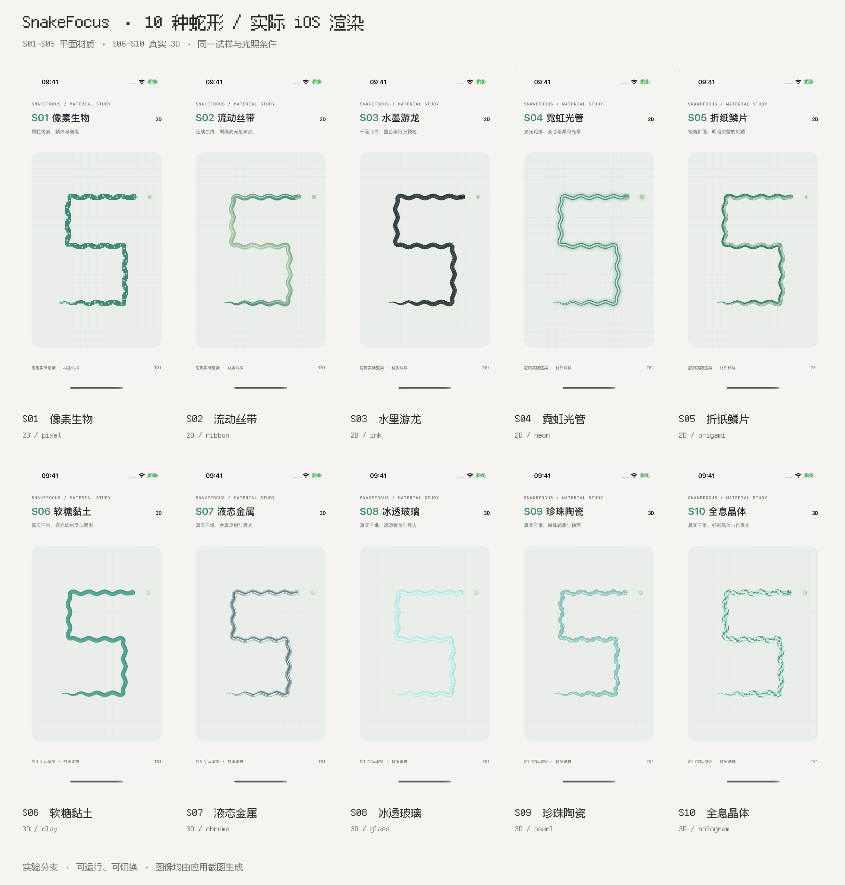
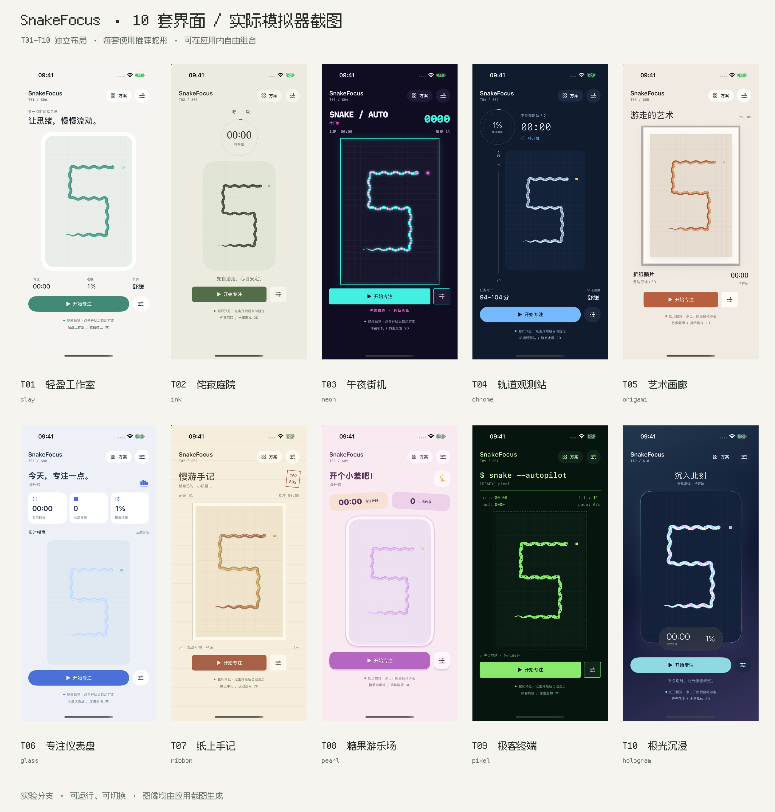

# SnakeFocus 风格实验室

实验分支：`codex/snake-design-lab`。从 `main` 的 `aecb849` 开出，保留原版界面、引擎、地图与模拟样本。这个分支运行后直接进入风格实验室。

## 怎么选

1. 用 Xcode 打开 `SnakeFocus.xcworkspace`，运行 `SnakeFocus` scheme。
2. 点右上角「方案」：在「界面 · 10」选择布局，在「蛇形 · 10」独立选择材质，共 100 种组合。
3. 「推荐搭配」会同时选择该界面推荐的蛇形；单独点击界面或蛇形时，另一项保持当前选择。
4. 点击书签收藏当前组合，在「收藏」中快速切换对比。选择与收藏保存在当前设备。
5. 设置按钮提供六张地图、四档速度和原有时长估算。「开始专注」启动原有自动贪吃蛇；暂停、重开、完成提示沿用同一会话逻辑。
6. 进行中可以切换界面和蛇形，游戏进度与计时继续保留。地图与速度在开局后锁定。方案页底部可打开「原版对照」。

开局时的较大 S 形是独立材质试样，便于看清材质。开始后展示实际游戏路径；试样不会写入或改变引擎。

## 10 种蛇形



| 编号 | 蛇形 | 实现与可见效果 | 实际渲染大图 |
| --- | --- | --- | --- |
| S01 | 像素生物 | 2D 像素栅格、原有鳞纹、波动与收尖尾部 | [查看](Previews/DesignLab/Snakes/S01-pixel.png) |
| S02 | 流动丝带 | 2D 连续变宽轮廓、绸缎高光、沿身渐变 | [查看](Previews/DesignLab/Snakes/S02-ribbon.png) |
| S03 | 水墨游龙 | 2D 干笔飞白、稳定颗粒、纸纤维与墨色层次 | [查看](Previews/DesignLab/Snakes/S03-ink.png) |
| S04 | 霓虹光管 | 2D 亮芯、双色管壁与模糊光晕，深色界面效果更明显 | [查看](Previews/DesignLab/Snakes/S04-neon.png) |
| S05 | 折纸鳞片 | 2D 多边形折面、纸鳞与明暗交替 | [查看](Previews/DesignLab/Snakes/S05-origami.png) |
| S06 | 软糖黏土 | 真实 3D 圆管、哑光表面、立体头部和接触阴影 | [查看](Previews/DesignLab/Snakes/S06-clay.png) |
| S07 | 液态金属 | 真实 3D 金属度、低粗糙度与程序生成的摄影棚环境反射 | [查看](Previews/DesignLab/Snakes/S07-chrome.png) |
| S08 | 冰透玻璃 | 真实 3D 透明壳、反射与细亮边，棋盘可透过管身显现 | [查看](Previews/DesignLab/Snakes/S08-glass.png) |
| S09 | 珍珠陶瓷 | 真实 3D 串珠式半径变化、收窄连接与带色釉面 | [查看](Previews/DesignLab/Snakes/S09-pearl.png) |
| S10 | 全息晶体 | 真实 3D 棱面网格、多色物理材质与自发光 | [查看](Previews/DesignLab/Snakes/S10-hologram.png) |

五种三维方案都使用实际网格、摄像机与灯光，不是三维图片贴图。玻璃采用实时双层透明与反射近似，没有光线追踪折射；全息采用多色棱面与自发光，没有基于视角的薄膜干涉模拟。

## 10 套界面



| 编号 | 界面 | 布置与风格 | 推荐蛇形 | 实际界面大图 |
| --- | --- | --- | --- | --- |
| T01 | 轻盈工作室 | 留白、柔和衬框、底部三项指标与胶囊操作 | S06 黏土 | [查看](Previews/DesignLab/Interfaces/T01-atelier.png) |
| T02 | 侘寂庭院 | 居中呼吸式排版、圆形计时、自然色与安静操作 | S03 水墨 | [查看](Previews/DesignLab/Interfaces/T02-zen.png) |
| T03 | 午夜街机 | 大号得分、像素气质、霓虹矩形框与街机操作 | S04 霓虹 | [查看](Previews/DesignLab/Interfaces/T03-arcade.png) |
| T04 | 轨道观测站 | 轨道进度仪表、方向标尺、任务状态与太空蓝 | S07 金属 | [查看](Previews/DesignLab/Interfaces/T04-observatory.png) |
| T05 | 艺术画廊 | 画框、衬纸、作品编号、展签与细字计时 | S05 折纸 | [查看](Previews/DesignLab/Interfaces/T05-gallery.png) |
| T06 | 专注仪表盘 | 三项指标卡、实时棋盘标题与信息栅格 | S08 玻璃 | [查看](Previews/DesignLab/Interfaces/T06-dashboard.png) |
| T07 | 纸上手记 | 横线纸、记录栏、旋转印章与手记式标题 | S02 丝带 | [查看](Previews/DesignLab/Interfaces/T07-paper.png) |
| T08 | 糖果游乐场 | 轻微旋转的指标贴纸、大圆角棋盘与厚实操作 | S09 珍珠 | [查看](Previews/DesignLab/Interfaces/T08-candy.png) |
| T09 | 极客终端 | 命令提示符、等宽字符指标、虚线边界与荧光绿 | S01 像素 | [查看](Previews/DesignLab/Interfaces/T09-terminal.png) |
| T10 | 极光沉浸 | 渐变光场、发光棋盘、悬浮计时胶囊与轻量操作 | S10 全息 | [查看](Previews/DesignLab/Interfaces/T10-aurora.png) |

各界面的颜色来自 `LabDesignCatalog.swift` 的独立配色，蛇材质会跟随界面的主色与辅助色。表中的推荐组合只是快捷选择，全部蛇形都能与全部界面组合。

## iOS 实现与参考

- 平面部分采用 SwiftUI Canvas：适合连续轮廓、图层、渐变、纹理和发光效果。[Apple Canvas 文档](https://developer.apple.com/documentation/swiftui/canvas)、[SwiftUI 绘图说明](https://developer.apple.com/documentation/swiftui/drawing-and-graphics)。
- 三维实验采用 SceneKit 的物理材质与程序网格，使用金属度、粗糙度、透明度、环境反射等属性。[Apple 物理光照模型](https://developer.apple.com/documentation/scenekit/scnmaterial/lightingmodel-swift.struct/physicallybased)、[SCNMaterial](https://developer.apple.com/documentation/scenekit/scnmaterial)。
- SceneKit 在新 SDK 中已进入弃用阶段，当前用于兼容 iOS 17 的独立实验。正式产品选定三维方向后，可将几何和材质迁移到 RealityKit；Apple 提供了对应的迁移说明。[WWDC25：Bring your SceneKit project to RealityKit](https://developer.apple.com/videos/play/wwdc2025/288/)。
- 所有本页参考图均由实验版实际截图生成，没有用 AI 概念图替代已经实现的视觉效果。

[金属材质在实际半满棋局中的效果](Previews/DesignLab/QA/live-chrome.png)与[小屏街机布局检查](Previews/DesignLab/QA/compact-arcade.png)也保存在预览目录，便于比较试样和真实路径。

## 验证与复现

- 模拟器：iPhone SE 第三代小屏布局检查，以及 iPhone 17 Pro 完整参考图。
- 五种三维材质按快照更新，复用灯光、材质和网格索引，动态管身约 800 环采样上限。暂停与后台停止 Timeline 连续更新，没有额外的 SceneKit 游戏计时器。
- `Scripts/check-design-lab.sh` 检查试样拓扑、跨边界分段、有限坐标、尾部半径，以及六张原版地图上的 559 个实际状态；原有视觉、估时和本地化检查继续适用。
- 独立的 `SnakeFocus-LabChecks` scheme 提供原生 XCTest UI 操作检查：主题与蛇形独立切换、开始 / 暂停 / 恢复、重开确认与取消、设置页关闭后重开，以及收藏恢复。实际运行 4 条测试，全部通过，0 失败。普通 `SnakeFocus` scheme 保持为应用运行入口。
- 三维运行效果已在模拟器检查；尚未对不同型号真机的帧率、发热和电量进行量化测量。

截图脚本使用已经构建的 Debug 应用：

```sh
python3 Scripts/capture-design-lab.py \
  --device YOUR_SIMULATOR_UDID \
  --app-path /path/to/Debug-iphonesimulator/SnakeFocus.app
```

需要 Pillow 生成总览。脚本保存 10 张蛇形、10 张界面和目录数据到 `Docs/Previews/DesignLab/`。Debug 支持 `--lab-theme=atelier`、`--lab-form=clay`；增加 `--lab-board-only` 只展示实际材质渲染试样。其余原版游戏预览参数仍然可用。

运行 UI 操作检查：

```sh
xcodebuild test -workspace SnakeFocus.xcworkspace -scheme SnakeFocus-LabChecks \
  -destination 'platform=iOS Simulator,id=YOUR_SIMULATOR_UDID' \
  -parallel-testing-enabled NO CODE_SIGNING_ALLOWED=NO
```
