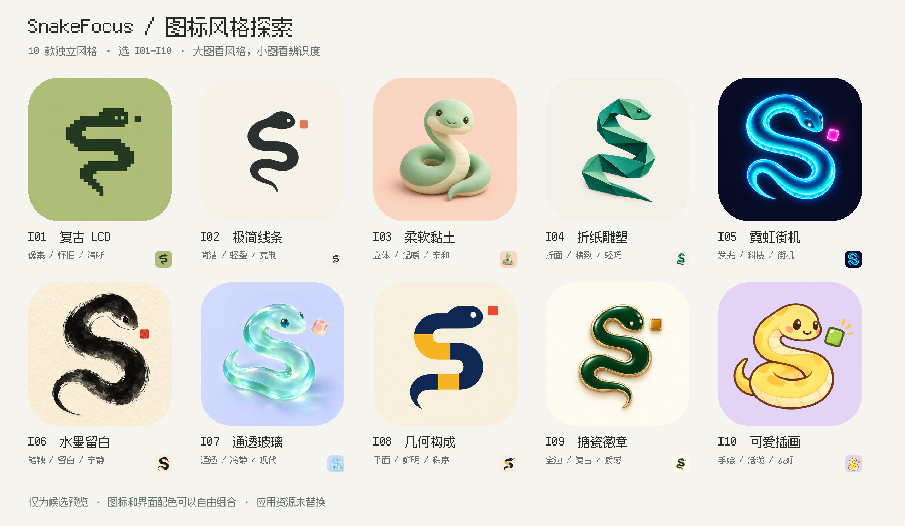
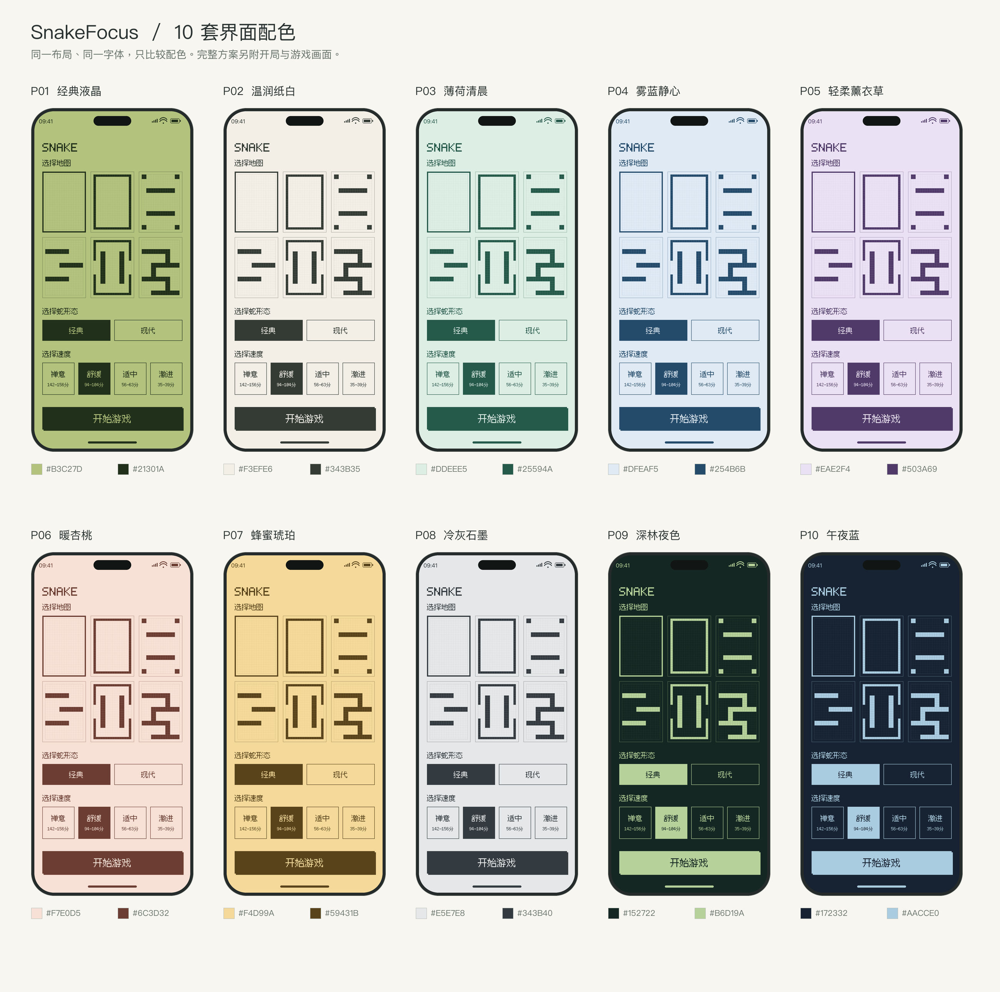

# SnakeFocus 图标与界面配色候选

2026-11-01 · 仅供选型的 20 个设计方案。图标与配色可以自由组合，例如「I03 + P09」。尚未替换应用图标或应用配色，未修改应用代码、工程配置及原有资源。

## 总览

## 图标大图

图标使用内置 ImageGen 分别生成，每款为独立的 1254 × 1254 不透明 PNG。每张图旁的同名 `.txt` 保留完整生成提示词。总览添加圆角遮罩，并展示小尺寸效果；独立原图保留满版方形画布。

| 编号 | 风格 | 独立大图 |
| --- | --- | --- |
| I01 | 复古 LCD | [查看](Icons/I01-retro-lcd.png) |
| I02 | 极简线条 | [查看](Icons/I02-minimal-line.png) |
| I03 | 柔软黏土 | [查看](Icons/I03-soft-clay.png) |
| I04 | 折纸雕塑 | [查看](Icons/I04-origami.png) |
| I05 | 霓虹街机 | [查看](Icons/I05-neon-arcade.png) |
| I06 | 水墨留白 | [查看](Icons/I06-ink-wash.png) |
| I07 | 通透玻璃 | [查看](Icons/I07-translucent-glass.png) |
| I08 | 几何构成 | [查看](Icons/I08-geometric.png) |
| I09 | 搪瓷徽章 | [查看](Icons/I09-enamel.png) |
| I10 | 可爱插画 | [查看](Icons/I10-kawaii.png) |

## 配色大图

每套 1280 × 1390 PNG 同时展示开局页与游戏页。保持现有像素界面、六张地图、两种蛇形态与四档速度的布局，只比较背景色与前景色。所有主文字与背景的对比度均高于 4.5:1；该数值仅针对两种基础颜色，不代表完整的无障碍评估。

| 编号 | 配色 | 背景 | 文字 / 蛇 / 操作 | 主色对比度 | 独立大图 |
| --- | --- | --- | --- | --- | --- |
| P01 | 经典液晶 | #B3C27D | #21301A | 7.27:1 | [查看](Palettes/P01-retro-lcd.png) |
| P02 | 温润纸白 | #F3EFE6 | #343B35 | 10.04:1 | [查看](Palettes/P02-warm-paper.png) |
| P03 | 薄荷清晨 | #DDEEE5 | #25594A | 6.69:1 | [查看](Palettes/P03-mint-morning.png) |
| P04 | 雾蓝静心 | #DFEAF5 | #254B6B | 7.50:1 | [查看](Palettes/P04-mist-blue.png) |
| P05 | 轻柔薰衣草 | #EAE2F4 | #503A69 | 7.76:1 | [查看](Palettes/P05-soft-lavender.png) |
| P06 | 暖杏桃 | #F7E0D5 | #6C3D32 | 7.05:1 | [查看](Palettes/P06-warm-apricot.png) |
| P07 | 蜂蜜琥珀 | #F4D99A | #59431B | 6.79:1 | [查看](Palettes/P07-honey-amber.png) |
| P08 | 冷灰石墨 | #E5E7E8 | #343B40 | 9.17:1 | [查看](Palettes/P08-cool-graphite.png) |
| P09 | 深林夜色 | #152722 | #B6D19A | 9.35:1 | [查看](Palettes/P09-forest-night.png) |
| P10 | 午夜蓝 | #172332 | #AACCE0 | 9.39:1 | [查看](Palettes/P10-midnight-blue.png) |

## 预览来源与检查

- 界面为按当前 `ContentView` 与 `PixelInterface` 绘制的静态视觉样稿，并非模拟器截图；使用仓库原有 Fusion Pixel 字体。
- 地图墙格与游戏页蛇身像素来自现有 `SnakeEngine` 和 `SnakeVisualGeometry` 的只读导出，固定 seed 42，游戏页示例为得分 60、计时 05:09；未修改引擎或模拟样本。
- [配色数据](Palettes/palettes.json) 保留名称、色值、文件名和对比度。
- 已检查 20 张独立 PNG 的尺寸、完整性、不透明度和编号，核对两张总览，并目视检查浅色与深色界面。
- 生成与排版脚本运行于仓库外的临时目录，仓库只新增设计预览、提示词与本说明；没有源代码或项目配置变更，因此没有触发模拟器构建。
